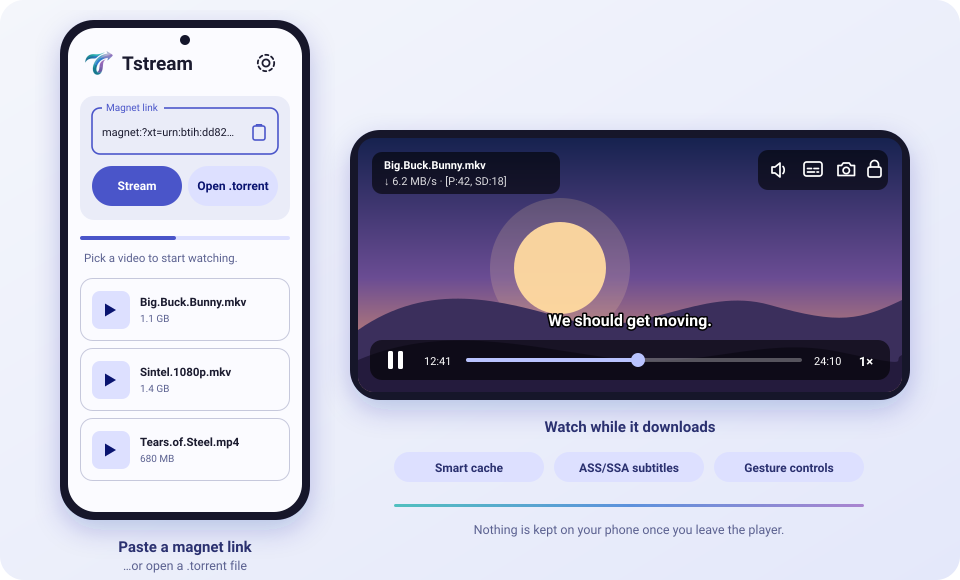

<div align="center">


<h1 align="center">Tstream</h1>

**Paste a magnet link. Pick a video. Watch it while it downloads.**

A lightweight Android torrent streamer with a full-featured video player and a tiny storage footprint.

<sub>Android 8.0+ &nbsp;·&nbsp; Kotlin &nbsp;·&nbsp; libmpv &nbsp;·&nbsp; libtorrent4j</sub>

<br />



</div>

---

## Highlights

| Feature | What it does |
|---|---|
| **Instant streaming** | Open a magnet link or a `.torrent` file, tap a video and it starts playing while the rest is still downloading. |
| **Smart cache** | Downloads only a small window around your position (25 MB ahead by default) and frees the part you have already watched (15 MB behind). A long movie never fills your storage. Turn it off to keep the whole file instead. |
| **Seed while watching** | Optionally give back to the swarm while you watch, with live upload speed in the player. |
| **Powerful player** | Powered by libmpv (mpv + FFmpeg): hardware decoding with automatic software fallback (10-bit HEVC and friends), and proper ASS/SSA subtitle styling. |
| **Tunable** | Advanced users can pass their own mpv options (with *Quality* and *Performance* presets) right from Settings. |

---

## Requirements

### To run the app

- Android **8.0 (API 26)** or newer
- An **ARM** device: `arm64-v8a` (nearly every phone since ~2017) or `armeabi-v7a` (older 32-bit phones)
- An internet connection
- Android 10+ to use the system folder picker for the cache location. Choosing a folder outside the app's own storage may ask for **All files access**.

### To build it

| Requirement | Version | Notes |
|---|---|---|
| **JDK** | 17 | Temurin / OpenJDK both work |
| **Gradle** | 8.13 or newer | No Gradle wrapper is bundled, so install Gradle yourself (or generate a wrapper, see step 5) |
| **Android SDK** | Platform **36** | Command-line tools or Android Studio |
| **Android NDK** | **26.1.10909125** | Builds the small native helper library |
| **CMake** | **3.22.1** | Installed through the SDK Manager |

Fetched automatically by Gradle: Android Gradle Plugin `8.13.2` and Kotlin `2.2.10`.

### Libraries used

| Library | Version | Purpose |
|---|---|---|
| [libtorrent4j](https://github.com/aldenml/libtorrent4j) | 2.1.0-35 | BitTorrent engine (arm64 and arm builds) |
| libmpv (`dev.jdtech.mpv`) | 1.0.0 | Video player (mpv 0.41 + FFmpeg 8.1) |
| AndroidX AppCompat | 1.7.0 | UI foundation |
| Material Components | 1.12.0 | Material 3 widgets and theming |
| AndroidX Lifecycle | 2.8.6 | Lifecycle-aware components |
| Kotlin Coroutines | 1.8.1 | Background work |
| JUnit | 4.13.2 | Unit tests |

---

## Building from source

The steps below use the command line on Linux or macOS. On Windows, use the same commands in PowerShell with `gradle.bat` / `sdkmanager.bat`, or just use Android Studio (see the shortcut at the end).

### 1. Get the code

```bash
git clone https://github.com/Quotiloquent/Tstream
cd Tstream
```

Or unzip the source archive and `cd` into the folder that contains `settings.gradle.kts`.

### 2. Install JDK 17

Install JDK 17 from your package manager or [adoptium.net](https://adoptium.net), then check it:

```bash
java -version      # should report 17.x
```

### 3. Install the Android SDK, NDK and CMake

If you already have Android Studio, open **Settings → Languages & Frameworks → Android SDK** and install *Android 16 (API 36)*, then under **SDK Tools** tick **NDK (Side by side) 26.1.10909125** and **CMake 3.22.1**.

Prefer the command line? Download the [command-line tools](https://developer.android.com/studio#command-line-tools-only), then:

```bash
export ANDROID_HOME="$HOME/android-sdk"

sdkmanager --sdk_root="$ANDROID_HOME" --licenses
sdkmanager --sdk_root="$ANDROID_HOME" \
  "platform-tools" \
  "platforms;android-36" \
  "ndk;26.1.10909125" \
  "cmake;3.22.1"
```

### 4. Tell Gradle where the SDK is

Either keep `ANDROID_HOME` exported, or create a `local.properties` file in the project root:

```properties
sdk.dir=/path/to/android-sdk
```

### 5. Install Gradle 8.13+

Install it from [gradle.org](https://gradle.org/install/) or with SDKMAN (`sdk install gradle 8.13`), then confirm:

```bash
gradle --version   # Gradle 8.13 or newer
```

Optional: generate a wrapper so you can use `./gradlew` from now on:

```bash
gradle wrapper --gradle-version 8.13
```

### 6. (Optional) Run the unit tests

```bash
gradle testDebugUnitTest
```

### 7. Build the release APKs

```bash
gradle assembleRelease
```

The first build downloads dependencies and compiles the native helper, so expect a few minutes. When it finishes, the APKs are in `app/build/outputs/apk/release/`:

| File | Use it for |
|---|---|
| `app-arm64-v8a-release.apk` | 64-bit ARM, almost every modern phone. **Pick this if unsure.** |
| `app-armeabi-v7a-release.apk` | 32-bit ARM, older phones |
| `app-universal-release.apk` | Both architectures in one (larger) file |

> Need a quick development build instead? Run `gradle assembleDebug`. The output lands in `app/build/outputs/apk/debug/`.

### 8. Install on your phone

Enable **USB debugging** on the phone, connect it, and run:

```bash
adb install -r app/build/outputs/apk/release/app-arm64-v8a-release.apk
```

Or copy the APK to the phone and open it (you may need to allow *Install unknown apps*).

### Android Studio shortcut

Open the project folder in a recent Android Studio (one that supports Android Gradle Plugin 8.13), let it sync, then choose **Build → Generate App Bundles or APKs → Generate APKs**, or press **Run ▶** with a device connected.